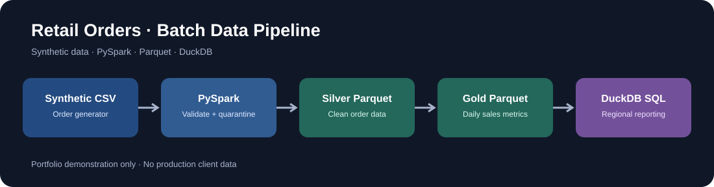

# Retail Orders Data Pipeline | PySpark + SQL + DuckDB

A self-contained **Data Engineering portfolio demonstration**: generate synthetic retail orders, ingest and validate data with Apache Spark, publish Silver and Gold Parquet layers, and query reporting results in DuckDB.

> **Disclosure:** Educational portfolio project using synthetic data. Not a client project, enterprise deployment, or claim of professional production ownership.



## Architecture

Synthetic CSV orders → PySpark ingestion & validation → Silver Parquet → Gold daily aggregates → DuckDB SQL reporting. Invalid rows and duplicate order IDs are quarantined separately.

## Technical highlights

- Explicit schemas, date parsing and field normalization
- Null/invalid-value checks and duplicate order-ID handling
- Row-count reconciliation between input, accepted and rejected data
- Silver Parquet partitioned by month
- Gold aggregate grouped by date and region
- Independent reporting layer with DuckDB SQL
- Unit tests and GitHub Actions verification workflow

## Requirements

Python 3.10+ and Java 17. Install dependencies:

```bash
python -m venv .venv
source .venv/bin/activate
pip install -r requirements.txt
```

## Run locally

```bash
python -m src.generate_data --rows 5000
python -m src.pipeline
python -m src.report
python -m pytest -q
```

On Windows PowerShell, activate the virtual environment using `.venv\Scripts\Activate.ps1`.

## Output structure

| Output | Description |
| --- | --- |
| `data/raw/orders.csv` | Generated synthetic orders |
| `data/processed/silver_orders/` | Valid standardized Parquet, month-partitioned |
| `data/processed/rejected_orders/` | Rejected and duplicate records |
| `data/processed/gold_daily_sales/` | Daily regional sales aggregation |
| Console | Reconciliation and DuckDB regional report |

Outputs and generated data are excluded from Git.

## Design decisions

- **Spark explicit schema:** Predictable typed transformations.
- **Quarantine:** Invalid records remain inspectable rather than silently dropped.
- **Silver / Gold separation:** Clear distinction between quality-controlled detail and reporting aggregates.
- **Parquet:** Column-oriented analytics storage.
- **DuckDB:** Local SQL consumption without external service credentials.

## Scope and limitations

This is a local batch demonstration. It does not claim production-grade scalability, incremental processing, idempotent upserts, orchestration, monitoring, cloud deployment or security hardening. The GitHub Actions workflow runs tests and an end-to-end example after code is pushed; inspect the actual run before claiming that complete execution passed.

## Author

Syed Ali Ur Rehman · [LinkedIn](https://www.linkedin.com/in/syed-ali02/)
